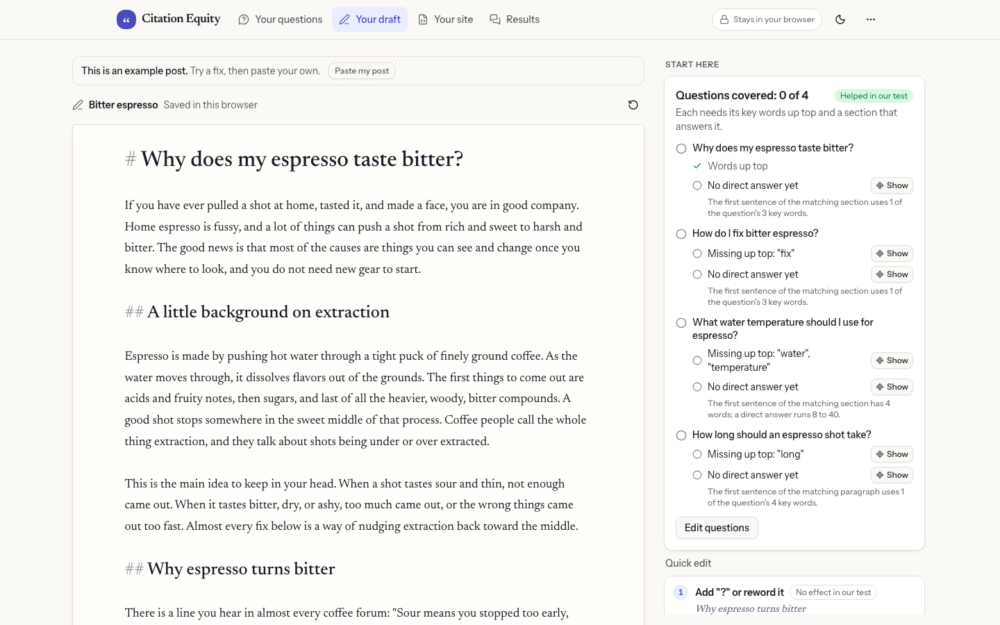

# Citation Equity

Citation Equity helps independent writers get cited by AI search. Start from the questions your readers ask, see which ones your draft covers, and check that AI search can reach your page; it suggests, you decide.

**[Try the demo](https://shehral.github.io/citation-equity/)**: free, open source and in your browser, with no account.



## What it does

1. **Start from your readers' questions**: type them, paste keywords, or import a Search Console or Bing Webmaster export.
2. **See which questions your draft covers**: their key words up top, and a section that answers each.
3. **Fix one thing at a time**: preview an edit, then apply; there is no apply-all.
4. **Check that engines can reach your page**: blockers such as a crawler shut out by robots.txt.
5. **Test before and after** on a free local model (live AI search may differ), and see who AI cites.

## How to use it

1. Open the demo and click **Try it with an example**, or type or import your readers' questions in **Your questions** and tick the ones your draft should answer.
2. Paste your post into **Your draft**. **Start here** shows **Questions covered**: whether each question's key words are up top and a section answers it. The **Quick edit** holds one ready edit: Preview it, then Apply. Other notes wait under **Writing notes**.
3. Paste your published page's HTML (and robots.txt) into **Your site** to see blockers: a crawler shut out, a noindex tag, or text that needs JavaScript.
4. In **Results**, test your draft before and after on a local model, and paste AI answers to see who gets cited.

## What our tests found

Each writing check and question carries a label for what our own tests found: Helped in our test, May help less, Unclear, Not tested or No effect in our test.

Of the single checks, only your reader's words near the top helped in our tests. Questions guessed from a keyword helped less in our test; questions a local AI wrote showed no clear gain. Details: [docs/evidence.md](docs/evidence.md).

## How we tested it

No check is graded strong yet, so the labels are a guide, not a forecast. The studies behind each check, our own tests and their numbers are in [docs/evidence.md](docs/evidence.md) and on the [Research page](https://shehral.github.io/citation-equity/research/). The data is on Hugging Face: [every result](https://huggingface.co/datasets/Shehral/citation-equity-experiments), with where each page came from and a hash of its text. The page text, edited versions, prompts and answers are not shared, since the pages belong to their publishers.

## Quick start

```sh
pnpm install && pnpm dev     # the app on http://localhost:3000
```

To test drafts on a local model, install [Ollama](https://ollama.com/download), quit its app, then:

```sh
OLLAMA_ORIGINS=https://shehral.github.io ollama serve   # http://localhost:3000 for pnpm dev
ollama pull llama3.2:3b
```

The app shows the right origin for wherever you opened it; without a local model it shows the recorded sample results.

## The command line

Build once (`pnpm install && pnpm build`), then run `pnpm ce <command>` from the repository root. Options: [docs/cli.md](docs/cli.md).

| Command             | What it does                                          |
| ------------------- | ----------------------------------------------------- |
| `ce analyze`        | Which reader questions a draft covers, and its notes. |
| `ce bench`          | Test a draft before and after, on a local model.      |
| `ce pack from-urls` | Build a test pack from pages you name.                |
| `ce pack cseo`      | Build a test pack from C-SEO Bench.                   |
| `ce site`           | Check if AI can read your published page.             |
| `ce signals logs`   | Count AI crawler visits in your access log.           |
| `ce signals bing`   | Read a Bing AI Performance export.                    |
| `ce questions`      | Reader questions from queries, keywords or a draft.   |
| `ce live`           | Ask Gemini with Google Search whether it cites you.   |
| `ce sources`        | See which sites AI answers cite.                      |

## Privacy

The web app has no server: drafts stay in your browser; the only request goes to your local Ollama, after you click. The CLI fetches only what you ask for: URLs you name, your local model, or a hosted API you choose, which then receives the draft.

## Documentation

- [docs/evidence.md](docs/evidence.md): the studies behind every check
- [docs/architecture.md](docs/architecture.md): modules, packages and data flow
- [docs/cli.md](docs/cli.md): every command, and how to make a test pack
- [samples/README.md](samples/README.md): the sample drafts and the test method
- [experiments/README.md](experiments/README.md): larger models on a GPU cluster
- [Hugging Face datasets](https://huggingface.co/datasets/Shehral/citation-equity-experiments): the experiments' results (no page text)
- [docs/roadmap.md](docs/roadmap.md): what comes next

## Development

```sh
pnpm lint && pnpm typecheck && pnpm test   # Biome, TypeScript, Vitest
pnpm e2e                                   # builds both static exports, then Playwright
```

The first `pnpm e2e` needs `pnpm --filter workspace exec playwright install chromium`. Node 24 and pnpm 10.

### Deploying your own copy

The demo is GitHub Pages, built by [.github/workflows/pages.yml](.github/workflows/pages.yml) on every push to `main`. For a fork, set Settings > Pages source to **GitHub Actions** and `NEXT_PUBLIC_BASE_PATH` in that workflow to `/<repo>`. Any static host works: `NEXT_PUBLIC_BASE_PATH=/<path> pnpm --filter workspace build` writes `apps/workspace/out`.

## Related work

[shehral/geo-measurement-prototype](https://github.com/shehral/geo-measurement-prototype): the August 2026 pre-work for this project.

## License

MIT ([LICENSE](LICENSE)). Adapted code and data, with their licenses: [NOTICE](NOTICE).

## Credits

Original design by Prof. Akram Bayat. Built by Mohammad Ali Shehral and Ishan Gupta, Northeastern University, Khoury College of Computer Sciences, San Jose. How this build maps onto her three-module design: [docs/architecture.md](docs/architecture.md#the-original-design).
