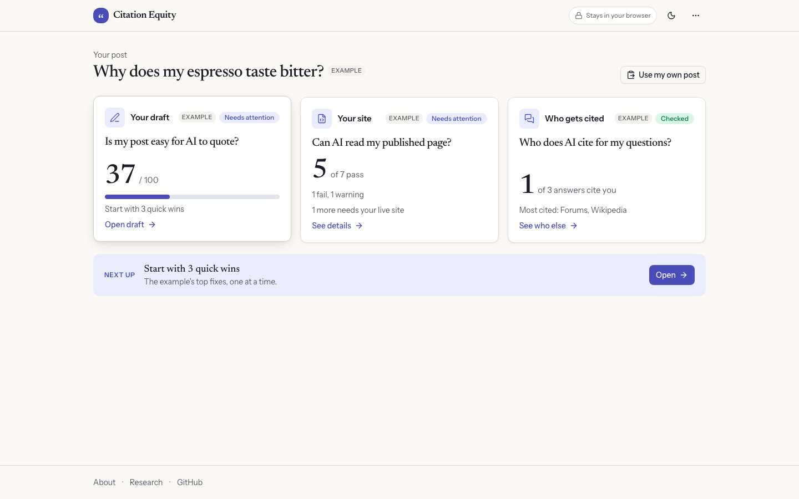

# Citation Equity

Citation Equity helps independent writers get quoted by AI search. Paste a draft, fix what makes it hard to quote, check your page and see who AI cites; it suggests, you decide.

**[Try the demo](https://shehral.github.io/citation-equity/)**: free, open source and in your browser, with no account.



## What it does

1. **Check your draft**: eleven writing checks and an AI-ready score from 0 to 100.
2. **Answer real questions**: turn your keywords, or your Search Console and Bing queries, into reader questions, with the searches AI may run behind each.
3. **Fix one thing at a time**: preview an edit, then apply, mark done or skip; there is no apply-all.
4. **Test before and after** on a free local model; live AI search may differ.
5. **See who AI cites** for your questions, and whether AI crawlers can read your page.

## How to use it

1. Open the demo and click **Try it with an example**, or paste your own post into Your draft.
2. Work through **Start here**: three fixes, always including a ready edit when the draft has one. Preview it, then Apply.
3. Open **All fixes** for the rest, grouped by check. **Helps** marks a check that helped in our tests; **Not scored** marks one that does not count toward the score unless you give it a weight.
4. Add the questions your readers ask under **Reader questions**, or build the list for your whole site in **Your questions** and use the ones this post answers.
5. Paste your published page's HTML into **Your site**, and AI answers into **Who gets cited**.

## How the score works

- Eleven checks, each scored 0 to 1; seven are averaged into the AI-ready score. The other four are shown as Not scored: they still suggest fixes, and a custom weight can count them.
- Two weightings, Standard and By evidence, both adjustable under Adjust weights.

## How we tested it

No check is graded strong yet, so the score is a writing checklist, not a forecast. The studies behind each check, our own tests and their numbers are in [docs/evidence.md](docs/evidence.md) and on the [Research page](https://shehral.github.io/citation-equity/research/). The data is on Hugging Face: [every result and score](https://huggingface.co/datasets/Shehral/citation-equity-experiments) (public) and [the page text, prompts and answers](https://huggingface.co/datasets/Shehral/citation-equity-experiments-pages) (gated, for research use).

## Quick start

```sh
pnpm install && pnpm dev     # the app on http://localhost:3000
```

To test drafts on a local model, install [Ollama](https://ollama.com/download), quit its app, then:

```sh
OLLAMA_ORIGINS=https://shehral.github.io ollama serve   # http://localhost:3000 for pnpm dev
ollama pull llama3.2:3b
```

The app shows the right origin for wherever you opened it; without a local model it shows the recorded sample results.

## The command line

Build once (`pnpm install && pnpm build`), then run `pnpm ce <command>` from the repository root. Options: [docs/cli.md](docs/cli.md).

| Command             | What it does                                        |
| ------------------- | --------------------------------------------------- |
| `ce analyze`        | Score a draft and list its fixes.                   |
| `ce bench`          | Test a draft before and after, on a local model.    |
| `ce pack from-urls` | Build a test pack from pages you name.              |
| `ce pack cseo`      | Build a test pack from C-SEO Bench.                 |
| `ce site`           | Check if AI can read your published page.           |
| `ce signals logs`   | Count AI crawler visits in your access log.         |
| `ce signals bing`   | Read a Bing AI Performance export.                  |
| `ce questions`      | Reader questions from queries, keywords or a draft. |
| `ce live`           | Ask Gemini with Google Search whether it cites you. |
| `ce sources`        | See which sites AI answers cite.                    |

## Privacy

The web app has no server: drafts stay in your browser; the only request goes to your local Ollama, after you click. The CLI fetches only what you ask for: URLs you name, your local model, or a hosted API you choose, which then receives the draft.

## Documentation

- [docs/evidence.md](docs/evidence.md): the studies behind every check
- [docs/architecture.md](docs/architecture.md): modules, packages and data flow
- [docs/cli.md](docs/cli.md): every command, and how to make a test pack
- [samples/README.md](samples/README.md): the sample drafts and the test method
- [experiments/README.md](experiments/README.md): larger models on a GPU cluster
- [Hugging Face datasets](https://huggingface.co/datasets/Shehral/citation-equity-experiments): the experiments' results, plus [gated page text](https://huggingface.co/datasets/Shehral/citation-equity-experiments-pages)
- [docs/roadmap.md](docs/roadmap.md): what comes next

## Development

```sh
pnpm lint && pnpm typecheck && pnpm test   # Biome, TypeScript, Vitest
pnpm e2e                                   # builds both static exports, then Playwright
```

The first `pnpm e2e` needs `pnpm --filter workspace exec playwright install chromium`. Node 24 and pnpm 10.

### Deploying your own copy

The demo is GitHub Pages, built by [.github/workflows/pages.yml](.github/workflows/pages.yml) on every push to `main`. For a fork, set Settings > Pages source to **GitHub Actions** and `NEXT_PUBLIC_BASE_PATH` in that workflow to `/<repo>`. Any static host works: `NEXT_PUBLIC_BASE_PATH=/<path> pnpm --filter workspace build` writes `apps/workspace/out`.

## Related work

[shehral/geo-measurement-prototype](https://github.com/shehral/geo-measurement-prototype): the August 2026 pre-work for this project.

## License

MIT ([LICENSE](LICENSE)). Adapted code and data, with their licenses: [NOTICE](NOTICE).

## Credits

Original design by Prof. Akram Bayat. Built by Mohammad Ali Shehral and Ishan Gupta, Northeastern University, Khoury College of Computer Sciences, San Jose. How this build maps onto her three-module design: [docs/architecture.md](docs/architecture.md#the-original-design).
